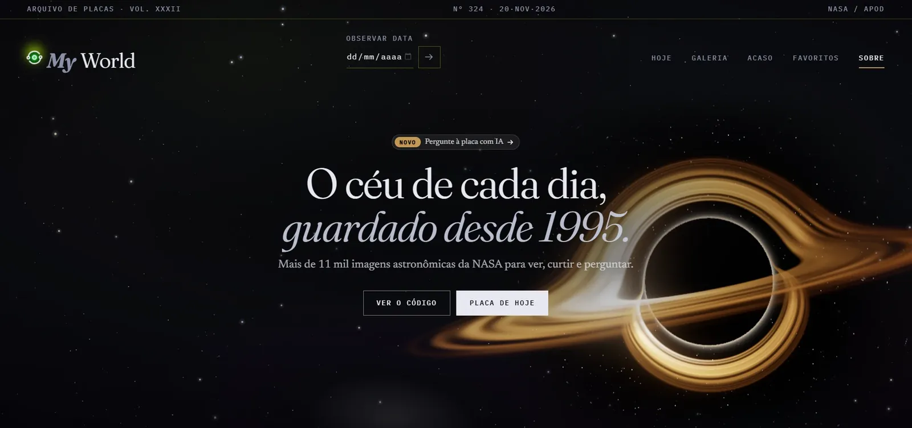
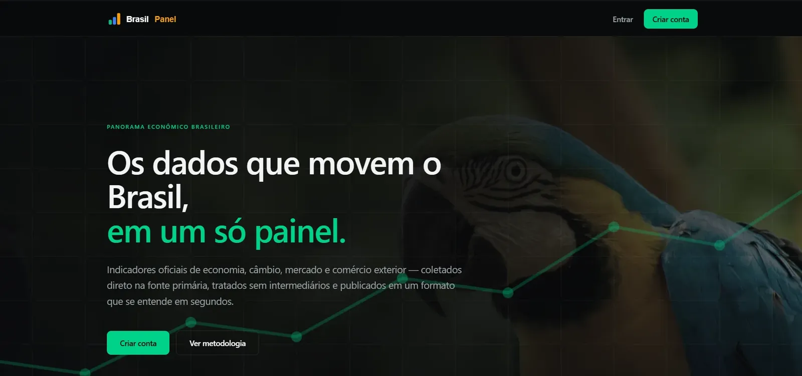

<div align="center">

# Jailton Santos

**Desenvolvedor full-stack, com foco em back-end.**
APIs em Java e Python, integrações com dezenas de fontes de dados, cache, autenticação e deploy em nuvem.

[**→ Ver o portfólio no ar**](https://jayzmatos22.github.io/portifolio/)

[jailtonmatos200@gmail.com](mailto:jailtonmatos200@gmail.com) · [github.com/Jayzmatos22](https://github.com/Jayzmatos22)

</div>

---

## Sobre mim

Construo o lado que ninguém vê: APIs, integrações, cache, autenticação e infraestrutura. Gosto de pegar
dez fontes de dados diferentes e devolver uma resposta rápida, segura e previsível, rodando em produção,
não só no localhost.

Hoje trabalho principalmente com **Java + Spring Boot** e **Python + FastAPI**, e levo o projeto até o
deploy: containers, serverless na AWS e bancos gerenciados.

| | |
|---|---|
| **Formação** | Análise e Desenvolvimento de Sistemas · Unisa · previsão jul/2027 |
| **Foco** | back-end: APIs, integrações e dados |
| **Status** | aberto a oportunidades |

## Minha stack

| Área | Tecnologias |
|---|---|
| **Linguagens** | Java 21 · Python 3.13 · TypeScript · SQL |
| **Back-end** | Spring Boot · Spring Security (JWT) · JPA / Hibernate · FastAPI · Pydantic v2 |
| **Dados** | PostgreSQL · DynamoDB · Caffeine (cache) · HikariCP · integração com APIs REST externas |
| **Cloud & DevOps** | AWS Lambda + SAM · S3 + CloudFront · CloudWatch · Docker · Render · Neon · GitHub Actions |
| **Front-end** | React 19 · TypeScript · Tailwind CSS 4 · Vite · TanStack Query · WebGL |

## Projetos em destaque

### 01 · MyWorld — Full-stack · Serverless · IA



Um arquivo editorial do céu: a Astronomy Picture of the Day da NASA desde 1995, com um assistente de IA
para conversar sobre cada imagem.

- API em **FastAPI** que busca, normaliza e faz cache do APOD direto do science.nasa.gov
- "Pergunte à placa": ponte para **3 provedores de LLM** (NVIDIA, Groq, Google), com provedor e modelo validados no servidor
- Curtidas, ranking e rate limit no **DynamoDB**, com IP anonimizado
- **100% serverless** no nível gratuito da AWS: Lambda + Mangum, S3 + CloudFront, alarmes no CloudWatch

**Stack:** Python 3.13 · FastAPI · Pydantic v2 · AWS Lambda · DynamoDB · S3 + CloudFront · AWS SAM · React 19 · TypeScript · WebGL

[Site no ar](https://d3qm8fzq1hw1xt.cloudfront.net/) · [Código](https://github.com/Jayzmatos22/MyWorld)

### 02 · Brasil Panel — Full-stack · Dados · Finanças



Painel de dados econômicos e financeiros do Brasil: indicadores oficiais, cotações, séries históricas e
dados geográficos numa interface rápida.

- Back-end em **Spring Boot** que integra **10 APIs** públicas e privadas: BCB, IBGE, IPEA, World Bank, CoinGecko e outras
- Persistência em **PostgreSQL** com JPA/Hibernate e pool de conexões HikariCP
- Autenticação **JWT em cookie HttpOnly** com Spring Security
- Cache **Caffeine** com TTL por domínio, Swagger, container no Render e banco serverless no Neon

**Stack:** Java 21 · Spring Boot 3.5 · Spring Security · JPA / Hibernate · PostgreSQL · Caffeine · Docker · React 19 · TanStack Query

[Código](https://github.com/Jayzmatos22/brasil_panel_utilities-api)

---

## Sobre este portfólio

Um site com tema de terminal, escrito em TypeScript puro, sem framework de UI.

- **Retrato em ASCII ao vivo:** uma lente segue o cursor e revela a foto real
- **Terminal interativo (`jsh`):** comandos `help`, `whoami`, `projetos`, `galeria`, `formacao`, `neofetch`, `theme`, `matrix`…, com autocomplete por Tab e histórico
- **Galeria 3D de telas** por projeto: arco em perspectiva, arrasto, teclado e visualizador em tela cheia
- **Visuais ao vivo** em canvas: buraco negro (MyWorld) e gráfico com log de requisições (Brasil Panel)
- Animações guiadas pelo scroll, scroll suave, cursor customizado e respeito a `prefers-reduced-motion`

| | Tecnologias |
|---|---|
| **Linguagem e build** | TypeScript (strict) · Vite |
| **Animação** | GSAP (ScrollTrigger + SplitText) · Lenis · Canvas 2D · CSS 3D |
| **Testes** | Vitest · cobertura com @vitest/coverage-v8 |
| **CI/CD** | GitHub Actions (testes e build em PRs, deploy a cada push na `main`) · GitHub Pages |

### Rodar localmente

```powershell
npm install
npm run dev
```

| Script | O que faz |
|---|---|
| `npm run dev` | servidor de desenvolvimento com hot reload |
| `npm run build` | checa os tipos (`tsc`) e gera o site em `dist/` |
| `npm run preview` | serve o build de produção |
| `npm test` | testes unitários (Vitest) |
| `npm run coverage` | testes com relatório de cobertura |

### Onde editar

Todo o conteúdo fica em **`src/data/content.ts`**. O site e o terminal leem desse mesmo arquivo, então
tudo fica sincronizado.

| O quê | Onde |
|---|---|
| Nome, e-mail, links | `profile` |
| Formação | `education` |
| Projetos e telas da galeria | `projects` (imagens em `src/assets/projects/<projeto>/`) |
| Stack | `stack` |
| Cores / tokens | `src/styles/base.css` → `:root` |

### Estrutura

```
src/
  main.ts               ponto de entrada
  types.ts              tipos do conteúdo (Profile, Project, Screenshot, Education…)
  data/content.ts       todo o conteúdo do site
  anim/motion.ts        Lenis + GSAP: entrada, reveals, parallax, texto por scroll
  gallery/              galeria 3D (arc.ts = geometria pura, testada)
  portrait/             retrato ASCII (ascii.ts = matemática pura, testada)
  terminal/             o shell jsh (shell-utils.ts = lógica pura, testada)
  visuals/              buraco negro e gráfico ao vivo
  ui/                   render dos dados, efeitos, boot
  lib/                  helpers (math, text, dom, ticker, theme)
  styles/               base.css, sections.css, gallery.css
```
